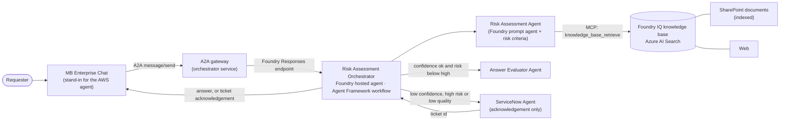

# Architecture

## Overview

| Part | What it is | Where it runs |
|---|---|---|
| MB Enterprise Chat | Small web service + Foundry agent (`mb-enterprise-chat-agent`); intake, optional clarifying question, final wording. Also serves the demo UI | Your PC (represents the AWS-hosted agent) |
| Risk Assessment Orchestrator | Workflow: Intake → Risk Assessment → Evaluation → Answer / Escalation, with conditional edges | **Foundry hosted agent** (`risk-orchestrator`, Microsoft Agent Framework), or locally for the offline demo |
| Risk Assessment Agent | Foundry prompt agent. Calls the knowledge base, drafts the answer, scores confidence, assesses risk using the criteria in `config/risk_criteria.yaml` | Foundry |
| Answer Evaluator Agent | Foundry prompt agent (LLM judge): groundedness, relevance, completeness, policy compliance | Foundry |
| ServiceNow Agent | Foundry prompt agent that prepares the incident; the ServiceNow call itself is a stub (`create_incident_stub`) that returns an acknowledgement | Foundry |
| Foundry IQ | Azure AI Search knowledge base `mb-enterprise-kb` with sources `mb-sharepoint-ks` (index of the HR documents) and `mb-web-ks` (web); agents reach it through an MCP project connection (`mb-kb-mcp`) | Azure AI Search |

**Routing rules** (code, not an LLM, in `src/mbpoc/policy.py`): confidence < 0.60 → human · risk HIGH → human · quality < 0.70 → human · otherwise the AI answer is returned. Thresholds and risk criteria are in `config/risk_criteria.yaml`.

LLM agents make the judgements (draft, risk, quality). The **routing is deterministic**, so it is testable and auditable.

## Check against the target design

Compared with your design drawing (MB Enterprise Chat → Risk Assessment Agent with SharePoint / Web / ERD data → confidence check → ServiceNow agent or evaluator) and the MB "target consultation process" slide.

| Target design element | Implemented | Notes |
|---|---|---|
| MB Enterprise Chat takes the user query and gets the answer back | Yes | Stand-in service; the real one sits on AWS |
| A2A connection from MB Enterprise Chat to Foundry | **Yes, through an A2A gateway** | Foundry cannot expose a *hosted* agent over A2A (tested: "Use a prompt agent as the A2A target"). So the orchestrator service publishes the A2A endpoint (JSON-RPC `message/send` + agent card at `/.well-known/agent-card.json`) and, with `ORCHESTRATOR_MODE=foundry`, forwards each request to the hosted agent. MB Enterprise Chat (the demo stand-in, or the real one on AWS) only speaks A2A. To be reachable from AWS the gateway has to run somewhere with a public address (for example Azure Container Apps) and be protected with authentication |
| Risk assessment agent with risk-criteria instructions | Yes | Criteria are in one YAML file and rendered into the agent's instructions |
| Data sources: SharePoint index, web search | Yes | SharePoint is a search index filled from documents (your tenant blocks the SharePoint connector for apps); the web source is the Foundry IQ web source |
| Data source: ERD data | **No (by decision)** | Left out for now; optional code is in `scripts/optional/` |
| Confidence score check; low → ServiceNow | Yes | |
| Risk high → ServiceNow | Yes | |
| Good score → agent evaluator checks answer quality | Yes | The evaluator runs only when confidence is fine and risk is not high, as in the slide's flow |
| Quality good → answer returned; not sufficient → human | Yes | |
| ServiceNow agent creates incident and acknowledges back to the requester | Yes (mock) | Acknowledgement only |
| Retrieved answer sent to a human for approval | Partly | The AI draft is attached to the ticket; no approval screen or loop is built |
| Human in the loop and tests with evaluations | Partly | Human = ticket. Foundry evaluations are not run yet (`azd ai agent eval generate` / `eval run` is the next step) |
| Slide: identify applicable area (compliance, legal, tax) | Yes | `applicable_area` decides the ServiceNow assignment group |
| Slide: optional clarifying questions | Partly | MB Chat asks one question for vague requests; the reply is a new request (no memory of the earlier one) |
| Slide: multimodal request | No | Text only |
| Slide: human consultation, other stakeholders, handover | Out of scope | Happens on the ServiceNow / human side |
| Slide: request feedback on the solution | Partly | The reply asks "Was this helpful?"; feedback is not stored |
| Slide: agentic review and refinement of the risk criteria | Partly | Criteria are editable and every request records confidence, risk and quality; there is no automated review loop |

**Conclusion:** the core decision flow of the design (data sources → draft + confidence → risk → evaluator → answer or ServiceNow hand-over, with MB Enterprise Chat as front door and A2A/Foundry connection) is implemented as designed. The open points are the ones marked *Partly / No* above; the largest are ERD data (deliberately skipped), a real SharePoint connector, a true A2A endpoint for the hosted agent, and Foundry evaluations for the human-in-the-loop / quality monitoring step.

## Two run modes

- **Simulation (no Azure):** local keyword search over `data/` and rule-based agents; same screens, events and flow.
- **Live:** real Foundry agents, Foundry IQ and (optionally) the hosted orchestrator. Selected by the `.env` file written by `setup.ps1`.

## Live UI events

Each step emits an event (`status`, `message`, `tool_call`, `kb_hit`, `scores`, `decision`). The UI subscribes over server-sent events. For the hosted agent, the run trace is returned with the response and replayed in the UI after the call finishes.

## Replacing the stand-ins

- **MB Enterprise Chat on AWS:** make it call the gateway's A2A endpoint (`/a2a`, card at `/.well-known/agent-card.json`); retire `mb_chat_api.py`. Host the gateway where AWS can reach it and add authentication.
- **ServiceNow:** replace `create_incident_stub()` in `src/mbpoc/agents/servicenow.py`; the `Ack` contract stays.
- **Real SharePoint:** use the indexed SharePoint knowledge source (needs an Entra app with `Sites.Read.All` and admin consent in the SharePoint tenant, `SHAREPOINT_MODE=native`) or `scripts/sync_documents.py --graph`.
