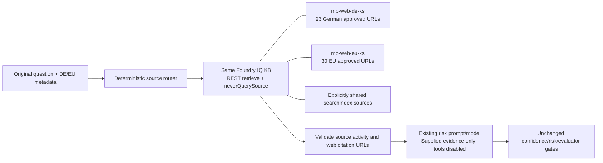

# Architecture

## Overview

| Part | What it is | Where it runs |
|---|---|---|
| MB Enterprise Chat | Small web service with local topic checking, original-question forwarding and deterministic result formatting; no intake/presentation model calls. Also serves the demo UI. The prompt agent `mb-enterprise-chat-agent` is retained for experimentation but is not invoked by the demo | Your PC (represents the AWS-hosted agent) |
| Risk Assessment Orchestrator | Workflow: Intake → Risk Assessment → Evaluation → Answer / Escalation, with conditional edges | **Foundry hosted agent** (`risk-orchestrator`, Microsoft Agent Framework), or locally for the offline demo |
| Risk Assessment Agent | Foundry prompt agent. Calls the knowledge base, drafts the answer, scores confidence, assesses risk using the criteria in `config/risk_criteria.yaml` | Foundry |
| Answer Evaluator Agent | Foundry prompt agent (LLM judge): groundedness, relevance, completeness, policy compliance | Foundry |
| ServiceNow Agent | Foundry prompt agent that prepares the incident; the ServiceNow call itself is a stub (`create_incident_stub`) that returns an acknowledgement | Foundry |
| Foundry IQ | Azure AI Search knowledge base `mb-enterprise-kb` with sources `mb-sharepoint-ks` (index of the HR documents) and `mb-web-ks` (web); agents reach it through an MCP project connection (`mb-kb-mcp`) | Azure AI Search |

**Routing rules** (code, not an LLM, in `src/mbpoc/policy.py`): confidence < 0.60 → human · risk HIGH → human · quality < 0.70 → human · otherwise the AI answer is returned. Thresholds and risk criteria are in `config/risk_criteria.yaml`.

LLM agents make the judgements (draft, risk, quality). The **routing is deterministic**, so it is testable and auditable.

## Check against the target design

Compared with your design drawing (MB Enterprise Chat → Risk Assessment Agent with SharePoint / Web / ERD data → confidence check → ServiceNow agent or evaluator) and the MB "target consultation process" slide.

| Target design element | Implemented | Notes |
|---|---|---|
| MB Enterprise Chat takes the user query and gets the answer back | Yes | Stand-in service; the real one sits on AWS |
| A2A connection from MB Enterprise Chat to Foundry | **Yes, through an A2A gateway** | Foundry cannot expose a *hosted* agent over A2A (tested: "Use a prompt agent as the A2A target"). So the orchestrator service publishes the A2A endpoint (JSON-RPC `message/send` + agent card at `/.well-known/agent-card.json`) and, with `ORCHESTRATOR_MODE=foundry`, forwards each request to the hosted agent. MB Enterprise Chat (the demo stand-in, or the real one on AWS) only speaks A2A. To be reachable from AWS the gateway has to run somewhere with a public address (for example Azure Container Apps) and be protected with authentication |
| Risk assessment agent with risk-criteria instructions | Yes | Criteria are in one YAML file and rendered into the agent's instructions |
| Data sources: SharePoint index, web search | Yes | SharePoint is a search index filled from documents (your tenant blocks the SharePoint connector for apps); the web source is the Foundry IQ web source |
| Data source: ERD data | **No (by decision)** | Left out for now; optional code is in `scripts/optional/` |
| Confidence score check; low → ServiceNow | Yes | |
| Risk high → ServiceNow | Yes | |
| Good score → agent evaluator checks answer quality | Yes | The evaluator runs only when confidence is fine and risk is not high, as in the slide's flow |
| Quality good → answer returned; not sufficient → human | Yes | |
| ServiceNow agent creates incident and acknowledges back to the requester | Yes (mock) | Acknowledgement only |
| Retrieved answer sent to a human for approval | Partly | The AI draft is attached to the ticket; no approval screen or loop is built |
| Human in the loop and tests with evaluations | Partly | Human = ticket. Foundry evaluations are not run yet (`azd ai agent eval generate` / `eval run` is the next step) |
| Slide: identify applicable area (compliance, legal, tax) | Yes | `applicable_area` decides the ServiceNow assignment group |
| Slide: optional clarifying questions | Partly | MB Chat asks one question for vague requests; the reply is a new request (no memory of the earlier one) |
| Slide: multimodal request | No | Text only |
| Slide: human consultation, other stakeholders, handover | Out of scope | Happens on the ServiceNow / human side |
| Slide: request feedback on the solution | Partly | The reply asks "Was this helpful?"; feedback is not stored |
| Slide: agentic review and refinement of the risk criteria | Partly | Criteria are editable and every request records confidence, risk and quality; there is no automated review loop |

**Conclusion:** the core decision flow of the design (data sources → draft + confidence → risk → evaluator → answer or ServiceNow hand-over, with MB Enterprise Chat as front door and A2A/Foundry connection) is implemented as designed. The open points are the ones marked *Partly / No* above; the largest are ERD data (deliberately skipped), a real SharePoint connector, a true A2A endpoint for the hosted agent, and Foundry evaluations for the human-in-the-loop / quality monitoring step.

## Two run modes

- **Simulation (no Azure):** local keyword search over `data/` and rule-based agents; same screens, events and flow.
- **Live:** real Foundry agents, Foundry IQ and (optionally) the hosted orchestrator. Selected by the `.env` file written by `setup.ps1`.

## Live UI events

Each step emits an event (`status`, `message`, `tool_call`, `kb_hit`, `scores`, `decision`, `timing`). The UI subscribes over server-sent events. For the hosted agent, the run trace is returned with the response and displayed after completion without artificial pacing, preserving original timestamps. It is not a live hosted-stage stream. The gateway publishes a waiting status while Foundry runs; the chat shows an immediate receipt and elapsed time, not an unverified answer.

The front door makes no model calls and does not reword the question. Risk retrieval, scoring, evaluation and escalation remain unchanged. Timing events measure prompt-agent requests (including their tools), gateway round-trip and total chat time; they are overlapping measurements, not numbers to add together.

## Resource lifecycle and knowledge-base selection

### Optional single-KB jurisdiction routing

With `REGIONAL_RETRIEVAL_ENABLED=true`, the live risk stage changes from direct agent/MCP retrieval to:

DE permits DE+EU and the shared index; EU permits EU and the shared index. Every other attached source, including `mb-web-ks`, receives `neverQuerySource: true` for the request. Selection does not mutate the KB or agent bindings. There is no additional agent/skill and no automatic country inference. Missing selection prompts clarification in chat and is rejected by direct A2A/hosted requests.

The approved list is [config/approved_web_sources.yaml](../config/approved_web_sources.yaml). Importing a revised Excel file is local. [scripts/configure_regional.py](../scripts/configure_regional.py) previews locally by default; `--apply` explicitly creates/attaches missing regional sources on the existing KB, and `--update-sources` explicitly replaces their definitions. Other resources and customer prompt edits are preserved.

Regional REST requires `2026-08-01-preview`. Retrieval validates topology/allowlists each request, rejects partial/errors or activity outside the plan, checks web citation domain/path boundaries, and supplies actual evidence to assessment without MCP/web tools. The existing prompt/model is read, not overwritten. This enforcement applies only through the regional code path: directly invoking the existing prompt agent in the portal retains its original tools.

The hosted instance identity needs `Search Service Contributor` and `Search Index Data Reader` on the Search service and `Foundry User` on the Foundry project. Regional hosted deployment ensures/reuses these assignments. `Search Service Contributor` permits more than reads, but is the built-in role that exposes KB/source object definitions needed to validate the complete topology before retrieval.

`start.ps1 -RegionalDemo` is local/offline, with no Azure calls. Its source plan is simulated and answers still come from fictional sample policies. `retrieval_scope` events and `risk.retrieval` distinguish simulation from live retrieval. Local tests do not prove preview-service compatibility or legal accuracy.

The country catalogue is a source boundary, not proof that every selected source applies to a particular legal topic/state. Existing scope remains limited to DE/EU; no US websites or automated state/topic routing were added.

Default setup looks up named agents, connections and knowledge resources first. Existing definitions and document content are reused unchanged; missing resources are created. Lookup errors such as HTTP 403 are failures, never treated as "not found". Connection-target and risk-tool mismatches stop setup instead of silently overwriting customer configuration.

`setup.ps1 -UpdateExisting` explicitly opts into applying repository definitions. Prompt agents are versioned under the same names, never deleted first. Hosted deployment separately creates a revision of the same hosted orchestrator.

`setup.ps1 -KnowledgeBase "<name>" [-KBConnection "<name>"]` selects an existing KB on the configured Search service. It leaves the KB and sources untouched, ensures the MCP connection targets that KB, and changes only the risk prompt agent's KB tool binding in a new version, preserving customer instructions and other tools. Repeating the same selection is a no-op for the agent. The selected values are saved only after successful binding; an absent KB fails without creating it. Existing connections are not retargeted implicitly.

Changing the risk agent affects its other callers too; use a separate agent/project where isolation is required. Refresh hosted configuration with `deploy-hosted.ps1` after switching, then restart the demo. See the [customer guide](../README.md#reuse-resources-update-deliberately-or-switch-knowledge-bases).

## Replacing the stand-ins

- **MB Enterprise Chat on AWS:** make it call the gateway's A2A endpoint (`/a2a`, card at `/.well-known/agent-card.json`); retire `mb_chat_api.py`. Host the gateway where AWS can reach it and add authentication.
- **ServiceNow:** replace `create_incident_stub()` in `src/mbpoc/agents/servicenow.py`; the `Ack` contract stays.
- **Real SharePoint:** use the indexed SharePoint knowledge source (needs an Entra app with `Sites.Read.All` and admin consent in the SharePoint tenant, `SHAREPOINT_MODE=native`) or `scripts/sync_documents.py --graph`.
